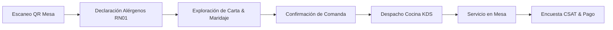
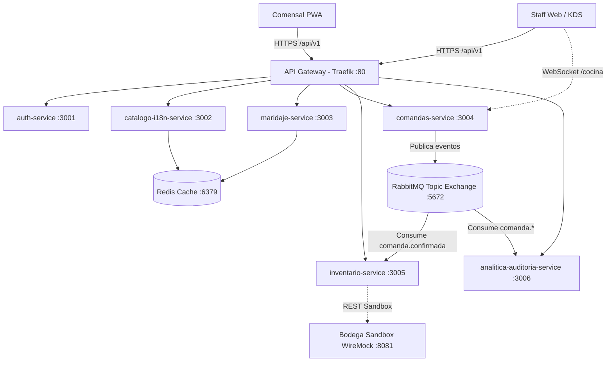

# TacamaMesa — Documento de Arquitectura Empresarial (TOGAF ADM)

> **Viña Tacama S.A. — El Tambo de Tacama (Ica, Perú)**  
> **Proyecto:** Sistema de Atención Digital del Restaurante  
> **Marco Metodológico:** TOGAF ADM (The Open Group Architecture Framework)

---

## 1. Introducción y Visión de la Arquitectura (Fase A)

**El Tambo de Tacama** es el restaurante de la viña más antigua de Sudamérica (fundada en 1540 en Ica, Perú). El restaurante recibe turistas nacionales e internacionales que buscan degustar la gastronomía iqueña maridada con vinos de alta gama y piscos de la casa.

### Objetivos Estratégicos
1. **Digitalizar la atención del comensal** mediante código QR en mesa sin obligar a descargas de apps nativas (PWA accesible).
2. **Potenciar la venta cruzada (Cross-selling)** recomendando maridajes enológicos específicos para cada plato (RN03, RN05).
3. **Garantizar la seguridad alimentaria** obligando y priorizando la declaración de alérgenos hacia la cocina en tiempo real (RN01).
4. **Optimizar la sincronización de inventario** de la cava y el salón mediante eventos asíncronos y conexión sandbox con la bodega.
5. **Asegurar trazabilidad y auditoría legal** de todas las operaciones mediante logs inmutables retenidos por 12 meses (RN11, RF22).

---

## 2. Arquitectura de Negocio (Fase B)

### Procesos de Negocio Principales

### Reglas de Negocio (RN)
- **RN01 (Declaración de Restricciones):** El sistema alerta e informa al personal sobre alérgenos declarados antes de autorizar la preparación.
- **RN03 (Filtrado por Stock):** Las sugerencias de maridaje solo incluyen etiquetas con `stockActual > 0`.
- **RN05 (Diversidad de Rango de Precio):** En la recomendación de maridaje se presenta al menos una opción accesible y una opción icono/premium.
- **RN06 (Descuento de Stock):** Al confirmarse una comanda, se descuentan las existencias correspondientes mediante eventos RabbitMQ.
- **RN07 (Reversión de Stock):** Si una comanda es anulada, se repone el stock automáticamente.
- **RN11 (Inmutabilidad de Auditoría):** Los registros de auditoría no pueden ser editados ni eliminados (retención de 12 meses).

---

## 3. Arquitectura de Sistemas de Información (Fase C)

### A. Arquitectura de Datos
Cada microservicio es dueño de su propio esquema en PostgreSQL para evitar acoplamientos (Database per Service pattern):

| Schema PostgreSQL | Microservicio Propietario | Entidades Principales |
|---|---|---|
| `auth` | `auth-service` | Usuario, Rol, SesionMesa |
| `catalogo` | `catalogo-i18n-service` | Categoria, Plato, TraduccionPlato, Alergeno |
| `maridaje` | `maridaje-service` | ReglaMaridaje, CriterioEnologico |
| `comandas` | `comandas-service` | Comanda, DetalleComanda, ValoracionCSAT |
| `inventario` | `inventario-service` | Etiqueta, Existencia, Lote, MovimientoStock |
| `analitica` | `analitica-auditoria-service` | LogAuditoria, EventoNegocio, IndicadorDiario |

### B. Arquitectura de Aplicaciones

---

## 4. Arquitectura Tecnológica (Fase D)

- **Frontend:** React 18, Vite 5, TailwindCSS / Vanilla CSS Tokens, Lucide Icons, Socket.IO Client.
- **Backend:** NestJS 10, TypeScript 5.3, Prisma ORM, Swagger/OpenAPI.
- **Mensajería & Tiempo Real:** RabbitMQ 3.12 (AMQP Topic Exchange), Socket.IO (WebSockets).
- **Caché & Persistencia:** Redis 7 Alpine, PostgreSQL 16 Alpine con esquemas independientes.
- **Gateway & Ingress:** Traefik v3.0 con balanceo de carga y enrutamiento dinámico.
- **Simulación Externa:** WireMock 3.4 (Sandbox aislado de la bodega de Viña Tacama).
- **Orquestación:** Docker Compose & Monorepo Turborepo + PNPM Workspaces.

---

## 5. Plan de Implementación y Gobernanza (Fase E & F)

1. **Fase 1 (Salón y Cocina Digital):** QR en mesas, carta multiidioma, alertas de alérgenos en cocina (KDS).
2. **Fase 2 (Enología Inteligente):** Recomendador de maridaje sommelier, integración con stock de salón.
3. **Fase 3 (Analítica Avanzada & Cava):** KPIs de conversión de maridaje, CSAT en tiempo real y conciliación con bodega central.
